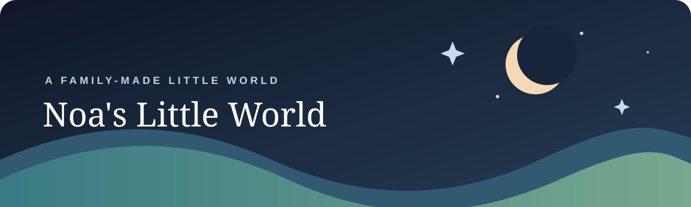

# Noa's Little World

<p align="center">
  
</p>

A family-managed website for little moments, playful discovery, stories, and
music. It uses the same responsive, multi-page React/Vite structure as the
source profile site, adapted for Noa and designed to keep childhood private.

## Pages and project structure

| Page | Purpose |
|---|---|
| `index.html` | Home, discovery cards, language starters, and music player |
| `about.html` | Family-managed project information |
| `timeline.html` | A privacy-conscious collection of memory themes |
| `protectedUSERS_root_path_secure/` | Optional guardian-only sign-in |

```text
src/                         React pages, components, and shared styling
api/                         Optional guardian sign-in API and Prisma schemas
starters/                    Small examples in eight programming languages
public/                      Static files and generated language metrics
scripts/                     Language-metrics generation
.github/workflows/           GitHub Pages and starter validation
```

## Development

```powershell
npm ci
npm run dev
npm run build
```

The optional API has separate setup steps in [`api/README.md`](./api/README.md).
The GitHub Pages site works without the API; family sign-in is unavailable
until an API and OAuth app are configured.

## Privacy and family access

- The public pages do not publish an exact age, school, location, routine,
  contact details, or personal social profile.
- Do not create or use a child account for sign-in. The optional family area
  must be restricted to guardian-approved adult GitHub logins through
  `ALLOWED_GITHUB_LOGINS`; access is denied when the allowlist is empty.
- Music selected from a device stays in that browser. The shared playlist is
  empty by default.
- Do not commit credentials. Use ignored local `.env` files or host secrets.
- Add only family-approved media and content.

See [`SECURITY.md`](./SECURITY.md) for reporting and configuration details.

## Language metrics

<!-- language-metrics:start -->
| Language | Equal starter share | Measured source share | Files | File types | Starter |
|----------|---------------------|-----------------------|-------|------------|---------|
| 🦀 Rust | 12.5% | 1.5% | 1 | `.rs` | [Open](./starters/rust/README.md) |
| 🐹 Go | 12.5% | 1.3% | 2 | `.go` | [Open](./starters/go/README.md) |
| 🐍 Python | 12.5% | 3.0% | 4 | `.py` | [Open](./starters/python/README.md) |
| 🔷 TypeScript | 12.5% | 64.8% | 23 | `.ts, .tsx` | [Open](./starters/typescript/README.md) |
| ⚡ JavaScript | 12.5% | 1.3% | 4 | `.js, .mjs, .cjs` | [Open](./starters/javascript/README.md) |
| 🗃️ SQL | 12.5% | 1.1% | 5 | `.sql` | [Open](./starters/sql/README.md) |
| 🎨 CSS | 12.5% | 25.9% | 5 | `.css` | [Open](./starters/css/README.md) |
| 🌐 HTML | 12.5% | 1.1% | 2 | `.html, .htm` | [Open](./starters/html/README.md) |
<!-- language-metrics:end -->

Metrics are generated before development and production builds with
`npm run generate:language-metrics`.

## Installable app and offline use

On supported browsers, choose **Install this app** in Settings or use the
browser's **Add to Home Screen** option. After the first online visit, the
service worker caches the app shell and static assets; previously opened pages
can then load offline. Music selected in the player is stored privately in
that site's IndexedDB on the current device. Browsers with the File System
Access API use its audio picker; other browsers keep the standard file picker.
Push notifications need a backend and are not enabled yet.

## License

Source code is released under the MIT License. See [`LICENSE`](./LICENSE).
